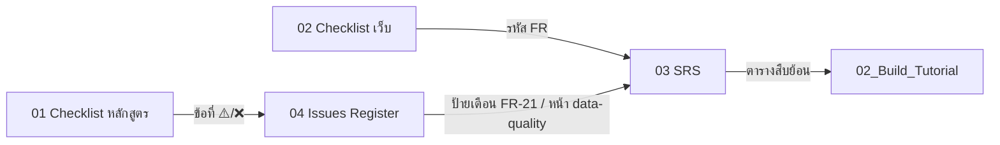

# Requirements · สิ่งที่หลักสูตรและเว็บต้องมี

| เอกสาร | ใช้ทำอะไร |
|---|---|
| [[01_Checklist_Curriculum_Data]] | ตรวจเล่ม มคอ.2 ทีละหมวด 66 รายการ (✅ 34 · ⚠️ 23 · ❌ 9) พร้อม action list |
| [[02_Checklist_Web_Data]] | ข้อมูลที่แต่ละหน้าเว็บต้องใช้ มาจาก field ไหน และพร้อมหรือยัง |
| [[03_SRS_Curriculum_Website]] | ข้อกำหนดระบบ: ไปป์ไลน์ข้อมูล (DP) · วอลต์ (VR) · เว็บ (FR) · NFR · data model · การทวนสอบ |
| [[04_Issues_Register]] | ข้อสังเกตของเล่ม ISS-01…56 จัดระดับ P0/P1/P2 พร้อมตำแหน่งและแนวทางแก้ |

> [!tip] ลำดับที่แนะนำ
> แก้ข้อ P0 ใน [[04_Issues_Register]] ก่อนเริ่มเขียนหน้า PLO/CLO ของเว็บ เพราะหน้าเหล่านั้นแสดงระดับ I/R/M ซึ่งตอนนี้แทบว่างทั้งหมด (ISS-01)
