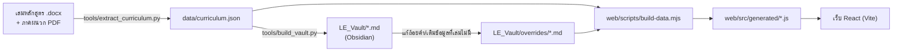
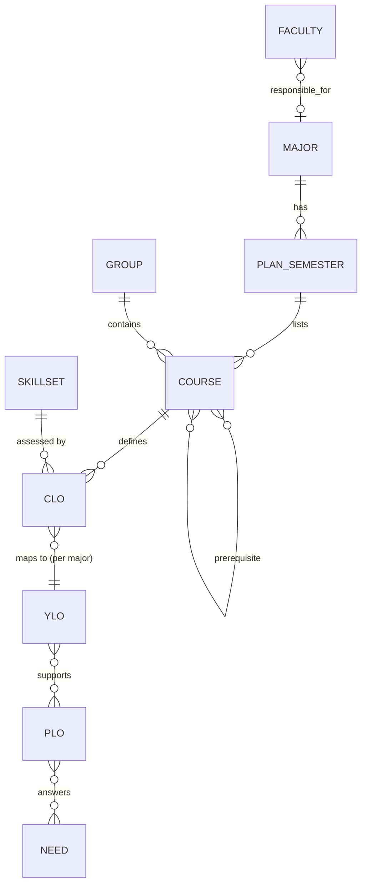

# SRS · เว็บไซต์และวอลต์หลักสูตร วศ.บ. วิศวกรรมโลจิสติกส์ (ปรับปรุง 2570)

> Software Requirements Specification ของระบบ **LE_web** ประกอบด้วย (1) Obsidian vault ที่เป็นแหล่งข้อมูลหลักสูตร (2) ตัวดึงข้อมูลจากเล่ม (3) เว็บไซต์ React สำหรับนำเสนอและตรวจสอบหลักสูตร
> ระดับความสำคัญใช้ MoSCoW: **M** = Must · **S** = Should · **C** = Could · **W** = Won't (รอบนี้)

## 1. บทนำ

### 1.1 วัตถุประสงค์
- นำเสนอหลักสูตรวิศวกรรมโลจิสติกส์ทั้ง 2 วิชาเอก (IE · SC) ในรูปที่สืบย้อนได้ตั้งแต่ความต้องการผู้มีส่วนได้ส่วนเสีย → PLO → YLO → CLO → รายวิชา → แผนการเรียน
- เป็นเครื่องมือทำงานของกรรมการพัฒนาหลักสูตร ให้เห็นช่องว่างของเล่ม (เช่น PLO ที่ไม่มีระดับ M) ก่อนเสนอสภามหาวิทยาลัย
- ใช้เป็นหลักฐานประกอบการประกันคุณภาพตามเกณฑ์ AUN-QA

### 1.2 ขอบเขต
**อยู่ในขอบเขต:** ข้อมูลทั้งหมดในเล่ม มคอ.2 ฉบับปรับปรุง 2570 และภาคผนวก ก–ง · วอลต์ Obsidian · ตัวดึงข้อมูล · เว็บแบบ static (SPA) ที่ deploy ได้บน Vercel หรือ static hosting

**นอกขอบเขต:** ระบบลงทะเบียนเรียน · การแก้ไขข้อมูลผ่านเว็บ · ข้อมูลตลาดงาน/ประกาศงาน · ระบบสมาชิกและการล็อกอิน

### 1.3 นิยามและคำย่อ

| คำ | ความหมาย |
|---|---|
| PLO | Program Learning Outcome · รหัส `PLO_LE1–4` (ร่วม), `PLO_IE1–5`, `PLO_SC1–4` |
| YLO | Yearly Learning Outcome · รหัส `IE-YLO1.1…`, `SC-YLO1.1…`, `YLO4.1–4.4` (ปี 4 ร่วม) |
| CLO | Course Learning Outcome · อ้างอิงแบบ `รหัสวิชา#CLOn` |
| I/R/M | ระดับการเรียนรู้ Introduce / Reinforce / Mastery |
| SK | ชุดทักษะ (Skill Set) `LE-SK01…`, `IE-SK01…`, `SC-SK01…` |
| IE / SC | วิชาเอกวิศวกรรมอุตสาหการ / วิชาเอกวิศวกรรมการจัดการโซ่อุปทาน |
| เล่ม | `doc_ref/วศ.บ.โลจิสติกส์ 70.docx` (ฉบับที่ใช้เป็นแหล่งข้อมูล) |

### 1.4 เอกสารอ้างอิง
- กฎกระทรวงมาตรฐานหลักสูตรการศึกษาระดับอุดมศึกษา พ.ศ. 2565 และมาตรฐานคุณวุฒิระดับอุดมศึกษา พ.ศ. 2565
- AUN-QA Assessment Model at Programme Level (version 4.0)
- [[01_Checklist_Curriculum_Data]] · [[02_Checklist_Web_Data]] · [[04_Issues_Register]]
- Template ต้นแบบ: `KSU-AI-EN/curriculum-graph` (React 18 + Vite 5 + React Router 6 + dagre)

## 2. คำอธิบายภาพรวม

### 2.1 มุมมองของระบบ

- **เล่มเป็นแหล่งความจริงลำดับแรก** ข้อมูลที่เล่มไม่มีหรือผิด ให้แก้ใน `LE_Vault/overrides/` เท่านั้น และห้ามพิมพ์ข้อมูลหลักสูตรลงไฟล์ `.js` โดยตรง
- ไฟล์ใน `web/src/generated/` เป็นไฟล์สร้างอัตโนมัติ ห้ามแก้ด้วยมือ

### 2.2 กลุ่มผู้ใช้

| กลุ่ม | สิ่งที่ต้องการจากระบบ | ความถี่ |
|---|---|---|
| U1 กรรมการพัฒนาหลักสูตร | เห็นช่องว่างและความไม่สอดคล้อง แก้ในวอลต์แล้วเห็นผลบนเว็บ | สูง (ช่วงพัฒนาหลักสูตร) |
| U2 อาจารย์ผู้สอน | ดู CLO ของรายวิชาตนเอง และ PLO/YLO ที่ต้องส่งเข้า | ปานกลาง |
| U3 นักศึกษา/ผู้สนใจสมัคร | ดูโครงสร้าง แผนการเรียน วิชาเอก อาชีพ | ปานกลาง (บนมือถือ) |
| U4 ผู้ประเมิน (AUN-QA / สป.อว.) | สืบย้อน PLO ↔ รายวิชา ↔ การประเมิน | ต่ำแต่สำคัญ |
| U5 ผู้ดูแลระบบ | รันตัวดึงข้อมูล build และ deploy | ต่ำ |

### 2.3 สภาพแวดล้อม
- Node.js ≥ 18 · Python ≥ 3.10 พร้อม `python-docx` · Obsidian ≥ 1.5
- เบราว์เซอร์: Chrome/Edge/Firefox/Safari 2 เวอร์ชันล่าสุด · มือถือ iOS Safari และ Android Chrome

### 2.4 ข้อจำกัด
- C1 เว็บต้องเป็น static ไม่มี backend
- C2 ภาษาหลักเป็นภาษาไทย คงศัพท์เทคนิค/รหัสเป็นภาษาอังกฤษ
- C3 ข้อมูลส่วนบุคคลของอาจารย์แสดงเฉพาะที่อยู่ในเล่ม (ชื่อ ตำแหน่ง คุณวุฒิ) ห้ามแสดงเลขประจำตัวหรือเบอร์โทรศัพท์
- C4 ใช้โครงเว็บจาก template เดิม (React 18, Vite 5, React Router 6, dagre, styles.css)

### 2.5 สมมติฐาน
- A1 เล่มฉบับ `.docx` เป็นฉบับล่าสุด (ถ้ามีฉบับใหม่ ให้รันตัวดึงข้อมูลซ้ำ)
- A2 โครงตารางในเล่มคงรูปแบบเดิม (รหัสวิชา `XX-000-00000`, CLO ขึ้นต้นด้วย `CLOn`)

## 3. ข้อกำหนดเชิงหน้าที่ (Functional Requirements)

### 3.1 ไปป์ไลน์ข้อมูล

| ID | ข้อกำหนด | ลำดับ | เกณฑ์ยอมรับ |
|---|---|:-:|---|
| DP-01 | ดึงรายวิชา CLO แผนการเรียน แผนที่ CLO→YLO→PLO PLO YLO อาจารย์ และชุดทักษะจากเล่มเป็น `curriculum.json` | M | นับได้ 90 วิชา · 254 CLO · 13 PLO · 27 YLO · 8+8 ภาค |
| DP-02 | ตัวดึงต้องหยุดพร้อม error เมื่อหัวข้อหลักหาไม่พบ หรือ parse ได้ 0 รายการ | M | ลบหัวข้อ "4.4" ในเล่มทดสอบแล้วตัวดึงล้มพร้อมข้อความชัดเจน |
| DP-03 | บันทึกข้อสังเกตอัตโนมัติ (รหัสซ้ำ รหัสไม่ครบหลัก ยอดหน่วยกิตไม่ตรง วิชาบังคับก่อนที่ไม่มีจริง PLO ไม่มีระดับ M) ลง `issues[]` | M | พบ EN-788-13009 ซ้ำ และ NS-531-1100 |
| DP-04 | ดึงหมวด 5–6 (กลยุทธ์ วิธีประเมิน น้ำหนัก ช่วงเวลา) | S | ✅ ทำแล้ว — น้ำหนักรวม 100% ทุก PLO ทั้งสองวิชาเอก (ตัวดึงตรวจอัตโนมัติ) |
| DP-05 | ดึงหมวด 7–9 (KPI แผนกลยุทธ์ ความเสี่ยง) | S | ✅ ทำแล้ว — เก็บหมวด 7–9 เป็นเอกสารเชิงโครง (หัวข้อ/ย่อหน้า/ตาราง) |
| DP-06 | ดึงภาคผนวก ก (ผลงานวิชาการ) และ ง (N01–N14) | C | |
| DP-07 | รวมข้อมูลจาก `LE_Vault/overrides/` ทับข้อมูลจากเล่ม พร้อมเก็บว่าค่าใดถูก override | S | หน้าเว็บแสดงไอคอน "แก้ไขจากเล่ม" |
| DP-08 | คำสั่งเดียว `npm run data` สร้างข้อมูลเว็บทั้งหมด | M | |

### 3.2 วอลต์ Obsidian

| ID | ข้อกำหนด | ลำดับ | เกณฑ์ยอมรับ |
|---|---|:-:|---|
| VR-01 | 1 โน้ตต่อ 1 รายวิชา / PLO / YLO / ชุดทักษะ / อาจารย์ ชื่อไฟล์เป็นรหัส | M | ลิงก์ `[[EN-788-12001]]` ใช้ได้ |
| VR-02 | ทุกโน้ตมี frontmatter (`type`, `code`, `major`, `year`, `plo`) เพื่อใช้ query | M | |
| VR-03 | ลิงก์ไขว้ CLO → YLO → PLO และวิชาบังคับก่อน เพื่อให้ Graph view แสดงความสัมพันธ์ | M | ไม่มีลิงก์เสีย |
| VR-04 | หน้า Home และหน้าดัชนีของแต่ละหมวด | M | |
| VR-05 | ชุดคู่มือ Build Tutorial (Prompt A วอลต์ / Prompt B เว็บ) | M | ทำตามได้ครบทุกขั้น |
| VR-06 | โน้ตที่สร้างอัตโนมัติมีป้าย "ห้ามแก้ — สร้างจากเล่ม" ส่วนการแก้ให้ทำใน `overrides/` | S | |

### 3.3 เว็บไซต์

| ID | ข้อกำหนด | ลำดับ | เกณฑ์ยอมรับ |
|---|---|:-:|---|
| FR-01 | ทุกหน้ามี URL ของตัวเอง แชร์ลิงก์ตรงได้ และ refresh ไม่ 404 | M | `vercel.json` rewrite |
| FR-02 | ตัวสลับวิชาเอก IE / SC / ทั้งหมด ที่มีผลกับทุกหน้า และจำค่าไว้ใน URL (`?major=IE`) | M | เปลี่ยนวิชาเอกแล้วแผนการเรียน PLO และแผนที่เปลี่ยนตาม |
| FR-03 | `/` หน้าแรก: ชื่อหลักสูตร ปรัชญา ตัวเลขสำคัญ 2 วิชาเอก เส้นทาง 4 ปี อาชีพ | M | |
| FR-04 | `/structure` และ `/structure/:id` แสดงหมวด กลุ่ม หน่วยกิต และรายวิชา | M | ผลรวม = 122 |
| FR-05 | `/courses` ค้นหาด้วยรหัส/ชื่อไทย/อังกฤษ และกรองตามกลุ่ม วิชาเอก ชั้นปี PLO | M | ค้น "คลังสินค้า" พบ 12002 |
| FR-06 | `/courses/:code` แสดงคำอธิบายไทย/อังกฤษ CLO + Bloom + YLO/PLO ตามวิชาเอก วิชาบังคับก่อน วิชาที่ต่อยอด และภาคที่เรียน | M | |
| FR-07 | `/plan` แสดงแผน 8 ภาคตามวิชาเอก พร้อมยอดรายภาคและยอดสะสม | M | ยอดสุดท้าย 122 ทั้งสองวิชาเอก |
| FR-08 | `/graph` กราฟวิชาบังคับก่อนจัดชั้นด้วย dagre โดยไม่มีกล่องทับกัน | S | node overlap = 0 |
| FR-09 | `/faculty` แสดงอาจารย์ 7 คน แยกผู้รับผิดชอบหลักสูตรตามวิชาเอก และประธานหลักสูตร | M | |
| FR-10 | `/obe` แสดงสายธาร ความต้องการ → PLO → YLO → CLO | S | |
| FR-11 | `/plo` แยก PLO ร่วม/IE/SC พร้อมประเภท Generic/Specific | M | |
| FR-12 | `/plo/:id` แสดงรายวิชาและ CLO ที่ส่งเข้า แยกตามชั้นปีและระดับ I/R/M | M | |
| FR-13 | `/ylo` และ `/ylo/:id` แสดง YLO ตามวิชาเอกและชั้นปี พร้อมรายวิชาที่ส่งเข้า | M | |
| FR-14 | `/clo` แสดงแผนที่ CLO→YLO→PLO รายภาค และตารางสรุปจำนวน CLO ต่อ PLO | M | IE 137 / SC 120 แถว |
| FR-15 | `/skills` แสดงชุดทักษะ 6 ชุด ทักษะย่อย ระดับ CLO และวิธีประเมิน | S | |
| FR-16 | `/teaching` แสดงกลยุทธ์การสอน 5 แบบกับรายวิชาและ PLO | S | ขึ้นกับ DP-04 |
| FR-17 | `/assessment` แสดงวิธีประเมินราย PLO น้ำหนัก ช่วงเวลา เกณฑ์ผ่าน และการทวนสอบ | S | ขึ้นกับ DP-04 |
| FR-18 | `/quality` แสดงระบบการจัดการ KPI แผนกลยุทธ์ 5 ปี และงบประมาณ | C | ขึ้นกับ DP-05 |
| FR-19 | `/refs` แสดงนโยบายและแผนที่อ้างอิง | C | |
| FR-20 | ชี้ที่ป้ายรหัส (PLO/YLO/วิชา/SK) แล้วแสดง tooltip คำอธิบายเต็ม และคลิกไปหน้ารายละเอียดได้ | S | ปิดด้วย Esc และปิดอัตโนมัติบนจอสัมผัส |
| FR-21 | ข้อมูลที่เล่มขาดหรือผิด ต้องแสดงป้ายเตือนที่จุดนั้น (เช่น "ยังไม่กำหนดระดับ I/R/M", "CLO อาจคัดลอกผิดวิชา") แทนการปล่อยว่าง | M | 13012, 13018 และ GE ที่ไม่มีคำอธิบายแสดงป้าย |
| FR-22 | `/data-quality` แสดงข้อสังเกตทั้งหมด จัดกลุ่มตามหมวดและความรุนแรง โดยลิงก์ไปหน้าที่เกี่ยวข้อง | S | |
| FR-23 | ส่งออกตาราง (แผนการเรียน แผนที่ CLO) เป็น CSV | C | |
| FR-24 | หน้าอาชีพ/ตลาดงาน/KSEC แบบ template | W | ไม่มีข้อมูลในเล่ม |

## 4. ข้อกำหนดข้อมูล (Data Model)

| Entity | คีย์ | field สำคัญ |
|---|---|---|
| Course | `code` | th, en, credits `n(l-p-s)`, group, majors[], descTh, descEn, prereq[], plan{IE,SC:{year,sem}}, plos[] |
| CLO | `code` + `n` | th, bloom, map{IE,SC:{ylo,plo,level}} |
| PLO | `id` | scope (LE/IE/SC), th, en, outcomeType, needs[], sources[], policy |
| YLO | `id` | major (IE/SC/ALL), year, th, plos[] |
| PlanSemester | major + year + sem | courses[], credits, cumulative |
| Group | `id` | cat, th, credits, pick, courses[] |
| Faculty | `no` | name, position, degrees, institutions, years, responsible, major, chair |
| SkillSet | `code` | name, group, type, subskills+level, CLOs, assessment |
| Issue | — | where, code, note, severity |

## 5. ข้อกำหนดที่ไม่ใช่หน้าที่ (Non-functional)

| ID | ข้อกำหนด | เกณฑ์ |
|---|---|---|
| NFR-01 ประสิทธิภาพ | โหลดหน้าแรกเร็ว | LCP < 2.5 วินาทีบน 4G · JS bundle หลัก < 400 KB gzip |
| NFR-02 Responsive | ใช้งานได้บนจอกว้าง 360px ขึ้นไป | ไม่มี horizontal scroll ยกเว้นในตารางที่ห่อด้วย scroll container |
| NFR-03 Accessibility | WCAG 2.1 AA | contrast ≥ 4.5:1 · ใช้คีย์บอร์ดได้ทุกเมนู · ตารางมี `<th scope>` |
| NFR-04 ฟอนต์ไทย | IBM Plex Sans Thai และ fallback เป็น Noto Sans Thai | ไม่มีสระลอยหรือวรรณยุกต์ซ้อน |
| NFR-05 ความถูกต้อง | ตัวเลขบนเว็บต้องมาจากการคำนวณจากข้อมูล ไม่ hard-code | ตรวจด้วยสคริปต์ `npm run check` |
| NFR-06 สืบย้อนได้ | ทุกค่าบนเว็บบอกได้ว่ามาจากหัวข้อใดของเล่มหรือจาก override ใด | |
| NFR-07 บำรุงรักษา | เปลี่ยนเล่มแล้วรัน `npm run data && npm run build` ได้เว็บใหม่โดยไม่แก้โค้ด | |
| NFR-08 Line ending | สคริปต์ทุกตัว normalise CRLF/LF ก่อน parse | |
| NFR-09 ความเป็นส่วนตัว | ไม่มี analytics หรือ tracker ภายนอก | |

## 6. การทวนสอบ (Verification)

| ประเภท | วิธี |
|---|---|
| ข้อมูล | `npm run check`: ยอดหน่วยกิตต่อภาค = ที่ระบุ · ผลรวม 122 · ทุก CLO ใน 4.5 มีรายวิชาใน 4.2 · ทุก PLO มี CLO · รายการ issue ไม่เพิ่มโดยไม่ตั้งใจ (snapshot) |
| วอลต์ | สคริปต์ตรวจลิงก์เสีย `[[...]]` = 0 |
| เว็บ | เปิดทุก route ใน browser แล้ว console ไม่มี error · build ผ่าน · ตรวจบนจอ 375px |
| ผู้ใช้ | กรรมการหลักสูตรตรวจหน้า `/data-quality` เทียบกับ [[01_Checklist_Curriculum_Data]] |

## 7. ตารางสืบย้อน (Traceability)

| Checklist เว็บ | FR | Tutorial step |
|---|---|---|
| ข้อมูลส่วนกลาง | FR-01, FR-02, FR-20 | [[01_Skeleton]] |
| หน้าแรก/โครงสร้าง/อาจารย์ | FR-03, FR-04, FR-09 | [[06_Curriculum_Structure]] |
| รายวิชา | FR-05, FR-06, FR-21 | [[07_Courses]] |
| กราฟ | FR-08 | [[08_Prerequisites]] |
| แผนการเรียน | FR-07 | [[09_Study_Plan]] |
| OBE/PLO | FR-10, FR-11, FR-12 | [[03_Stakeholders_and_Needs]] · [[04_PLO]] |
| YLO | FR-13 | [[05_YLO]] |
| CLO/แผนที่ | FR-14 | [[10_CLO_and_Mapping]] |
| ชุดทักษะ | FR-15 | [[11_Skill_Sets]] |
| การสอน/ประเมิน | FR-16, FR-17 | [[12_Teaching_and_Assessment]] |
| คุณภาพ/ความถูกต้องข้อมูล | FR-18, FR-22 | [[13_Quality_and_Management]] · [[14_Verification]] |
