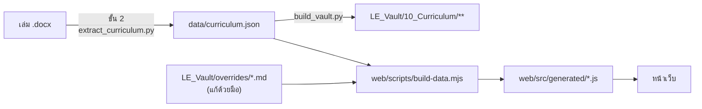

# คู่มือสร้างวอลต์และเว็บหลักสูตรทีละขั้น · วศ.บ. วิศวกรรมโลจิสติกส์ 2570

> สอนวิธีสร้างระบบ **LE_web** ตั้งแต่โฟลเดอร์เปล่าจนได้วอลต์ Obsidian และเว็บครบทุกเมนู
> ทุกขั้นมี **Prompt คู่กัน 2 ตัว**: **Prompt A** สร้างหรือตรวจข้อมูลในวอลต์ และ **Prompt B** สร้างหน้าเว็บที่ใช้ข้อมูลนั้น
> ใช้ร่วมกับ [[03_SRS_Curriculum_Website|SRS]] (รหัส FR/DP/VR) และ [[02_Checklist_Web_Data|Checklist ข้อมูลเว็บ]]

## ต่างจาก template ต้นแบบอย่างไร

Template `KSU-AI-EN` ออกแบบหลักสูตร AI **จากศูนย์** ส่วนหลักสูตรนี้ **มีเล่ม มคอ.2 อยู่แล้ว** คู่มือนี้จึงทำงานได้สองทิศ

| ทิศ | ใช้เมื่อ | จุดเริ่ม |
|---|---|---|
| **ย้อนจากเล่ม** (reverse) | มีเล่มแล้ว ต้องการตรวจและนำเสนอ | ขั้น 2: ดึงข้อมูลจากเล่ม → แล้วตรวจทีละขั้นตาม OBE |
| **ออกแบบใหม่** (forward) | ปรับปรุงรอบถัดไป หรือใช้คู่มือนี้กับหลักสูตรอื่น | ขั้น 3: เริ่มจากผู้มีส่วนได้ส่วนเสีย |

และมีความต่างเชิงโครงสร้าง 3 ข้อที่ต้องรองรับตลอดทั้งคู่มือ

1. **2 วิชาเอก** (IE · SC) ใช้หมวด GE/พื้นฐาน/วิชาชีพร่วมด้วยกัน แต่มี PLO, YLO, วิชาบังคับเอก และแผนการเรียนแยกกัน
2. **รหัส PLO เป็นข้อความ** (`PLO_LE1`, `PLO_IE3`, `PLO_SC2`) ไม่ใช่เลข 1–7 ทำให้ทุก `map`, สี และ route ต้องใช้คีย์แบบ string
3. **แผนที่ CLO→YLO→PLO แยกตามวิชาเอก** วิชาเดียวกัน (เช่น 12001) ส่ง CLO เข้า YLO คนละรหัสในแต่ละวิชาเอก

## ไปป์ไลน์ข้อมูล

## ลำดับทั้งหมด

### ส่วนที่ 1 · ตั้งโครงและดึงข้อมูล

| ขั้น | สร้างอะไร | เมนู/ผลที่ได้ | SRS |
|---|---|---|---|
| [[01_Skeleton\|1]] | โครง LE_web จาก template + ตัดส่วน AI ออก + ตัวสลับวิชาเอก | เมนูครบ (ยังว่าง) | FR-01, FR-02 |
| [[02_Source_Extraction\|2]] | ดึงเล่ม → `curriculum.json` → โน้ตในวอลต์ | ข้อมูลพร้อมใช้ + `issues[]` | DP-01–03, VR-01–03 |

### ส่วนที่ 2 · ใครต้องการอะไร → ผลลัพธ์

| ขั้น | สร้างอะไร | เมนู | SRS |
|---|---|---|---|
| [[03_Stakeholders_and_Needs\|3]] | ผู้มีส่วนได้ส่วนเสีย · ความต้องการ N01–N14 · นโยบาย | `/obe` | FR-10 |
| [[04_PLO\|4]] | PLO 13 ข้อ (ร่วม 4 + IE 5 + SC 4) | `/plo` `/plo/:id` | FR-11, FR-12 |
| [[05_YLO\|5]] | YLO 27 ข้อแยกวิชาเอกและชั้นปี | `/ylo` `/ylo/:id` | FR-13 |

### ส่วนที่ 3 · โครงสร้างที่รองรับ

| ขั้น | สร้างอะไร | เมนู | SRS |
|---|---|---|---|
| [[06_Curriculum_Structure\|6]] | อัตลักษณ์ · หมวด/กลุ่ม/หน่วยกิต 122 · อาจารย์ | `/` `/structure` `/faculty` | FR-03, FR-04, FR-09 |
| [[07_Courses\|7]] | 90 รายวิชา · คำอธิบายไทย/อังกฤษ · CLO | `/courses` `/courses/:code` | FR-05, FR-06, FR-21 |
| [[08_Prerequisites\|8]] | วิชาบังคับก่อนและกราฟ | `/graph` | FR-08 |
| [[09_Study_Plan\|9]] | แผน 8 ภาค × 2 วิชาเอก | `/plan` | FR-07 |

### ส่วนที่ 4 · ผูกกลับให้ครบวงและตรวจคุณภาพ

| ขั้น | สร้างอะไร | เมนู | SRS |
|---|---|---|---|
| [[10_CLO_and_Mapping\|10]] | แผนที่ CLO→YLO→PLO · ระดับ I/R/M · roll-up | `/clo` | FR-14 |
| [[11_Skill_Sets\|11]] | ชุดทักษะ 6 ชุดสำหรับ Skill Transcript | `/skills` | FR-15 |
| [[12_Teaching_and_Assessment\|12]] | กลยุทธ์การสอน · วิธีประเมิน · Rubric · การทวนสอบ | `/teaching` `/assessment` | FR-16, FR-17, DP-04 |
| [[13_Quality_and_Management\|13]] | หมวด 7–9 · KPI · แผน 5 ปี · งบประมาณ | `/quality` | FR-18, DP-05 |
| [[14_Verification\|14]] | ตรวจข้อมูล · ลิงก์ · build · หน้า data-quality | `/data-quality` | FR-22, NFR-05 |

## หลักการของคู่มือนี้

> [!important] กฎเหล็ก 4 ข้อ
> 1. **เล่ม → JSON → วอลต์/เว็บ** ห้ามพิมพ์ข้อมูลหลักสูตรลงไฟล์ `.js` โดยตรง
> 2. **แก้ที่ `overrides/` เท่านั้น** เมื่อต้องการแก้ถ้อยคำที่เล่มผิด หรือเติมสิ่งที่เล่มไม่มี (เช่น ระดับ I/R/M) เพื่อให้รันตัวดึงซ้ำแล้วการแก้ไม่หาย
> 3. **ห้ามซ่อนช่องว่างของเล่ม** ถ้าข้อมูลขาดหรือผิด ให้หน้าเว็บแสดงป้ายเตือน (FR-21) ไม่ใช่ปล่อยว่างหรือเดาเติมให้
> 4. **หนึ่งขั้น = หนึ่งเมนูที่เปิดดูได้จริง** และทุกขั้นต้องผ่านรายการ "ตรวจรับ" ท้ายขั้นก่อนไปต่อ

## วิธีใช้ Prompt ในคู่มือนี้

- **ระบุ path เต็มเสมอ** ทั้งไฟล์ต้นทางและปลายทาง (ราก = `LE_web/`)
- **สั่งให้พิมพ์สรุปจำนวนที่สร้างได้ทุกครั้ง** แล้วเทียบกับตัวเลขอ้างอิงในขั้นนั้น
- **สั่งให้ throw error เมื่อ parse ได้ 0 รายการ** และ normalise CRLF ก่อน parse
- **ระบุทุกครั้งว่าต้องรองรับ 2 วิชาเอก** มิฉะนั้นผู้ช่วยจะคัดลอกโครงแบบหลักสูตรเดียวจาก template มา

> [!warning] บทเรียนจากการดึงเล่มนี้รอบแรก
> - รหัส `NS-531-1100` ในตาราง 4.2 ขาดหลัก ถ้าใช้ regex `\d{4,5}` จะได้วิชาผีขึ้นมาหนึ่งวิชา ให้บังคับ 5 หลักแล้วแยกกรณีรหัสไม่ครบเป็น issue
> - หัวข้อ "คำอธิบายระดับการเรียนรู้" ในเล่มว่าง แล้วตามด้วยตารางแผนที่ทันที ห้ามเดาว่าเล่มใช้สัญลักษณ์อะไร
> - ค่า YLO บางแถวสะกดเพี้ยน เช่น `"YLO4.3 ("` ต้อง normalise ก่อนนำไป join

---

เริ่มที่ ➡ [[01_Skeleton]]
